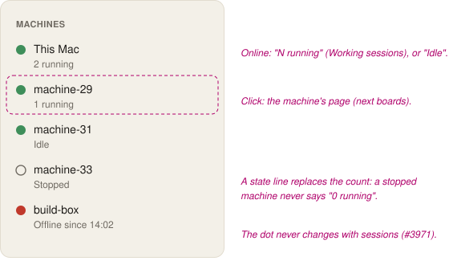
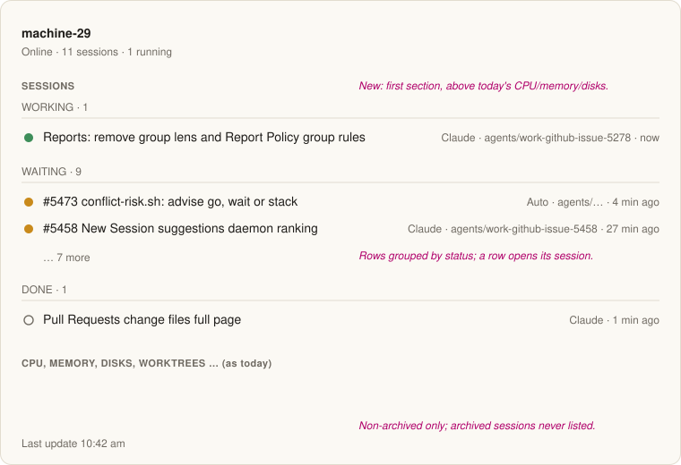
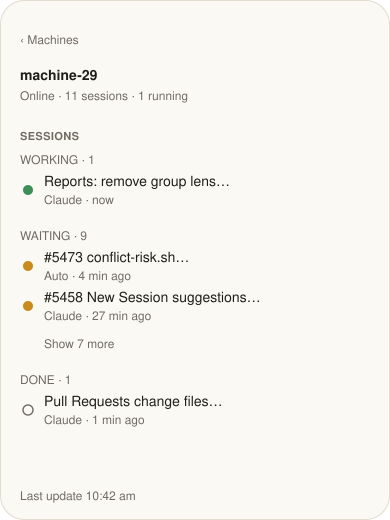

# Machines: running sessions in the sidebar, all sessions on the page (#5486)

**Status:** wireframes for Alex. **Clients:** Mac window and web (sidebar line and page section); the Remote gets the page section only (its `RemoteMachinePage`; no machine rows in its sidebar, #2798). **Feature:** `feature:machines`.

**Why:** a person decides where to schedule work by what already runs on a machine. Today they read every session row to find its machine.

## Changes

1. **Sidebar line.** Under an *online* machine's name: `N running` (sessions with status Working on that machine), or `Idle`. Any state line (`Stopped`, `Starting…`, `Offline since …`, `Disk 94% full`, setup failures, #3971) takes the line's place; the count shows again when the machine is online and not low on disk. The count never changes the dot or adds a "needs you" badge. This reverses "no count of sessions" in `specs/3971-machines-in-the-sidebar/wireframe.md` for running sessions only (Alex, 2026-11-14).
2. **Click** opens the machine's page, as today (no new route).

3. **Sessions section**, first on the page, above CPU/memory/disks. Header line gains `N sessions · M running`. Every non-archived session whose host is this machine, grouped **Working**, **Waiting**, **Done** (Needs-you sessions sit in Waiting with their usual marker), each group newest activity first. Row: status dot, title, runtime, branch (wide only), last active. Click opens the session. A group longer than 5 shows *Show N more*. Empty: `No sessions on machine-29.`
4. **Offline or stopped machine:** the section still lists its sessions as last known, headed `Last update <time ago>` (#5139).
5. **Words** are identical on all clients. Wide page: Mac and web. Narrow: web narrow and the Remote.

## Data

Sessions already carry their machine (`sessions/list` through the control plane). To check in the build: that every host's sessions come through, and that the count uses the same source as the page, so the two never disagree.

## Parity

Parity rows to change when built: sidebar machine row (Mac, web; Remote tier mac+web) and Machine page (all three).

## Approval

Needed: a new section on a screen and a new line in a row (#3474).
